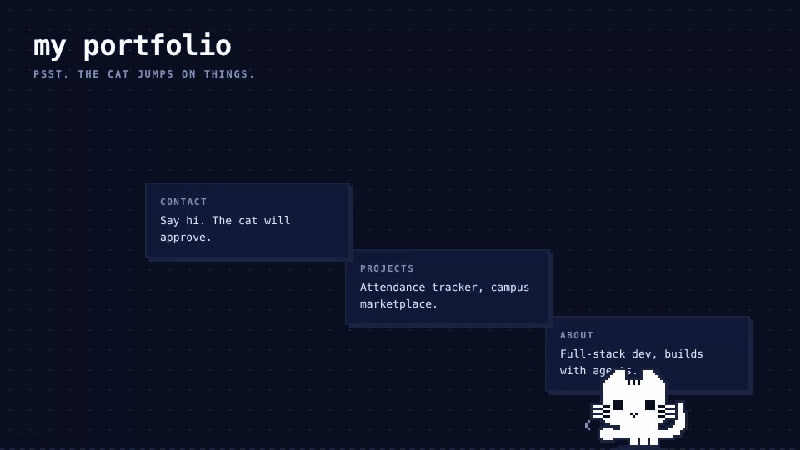
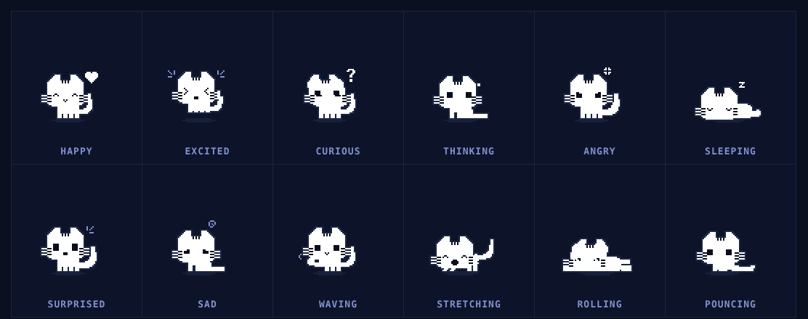

# K the pixel cat

**Meet K the pixel cat: an interactive pixel-art cat built for digital and web portfolios.**

Most portfolios are a stack of sections people scroll past. K the pixel cat gives your site a small, memorable bit of life: a cat that wanders along the bottom of the page, hops onto your headings and project cards, naps when visitors go quiet, and reacts when they click, drag or move the cursor. It makes your site feel handmade without getting in the way of your content.

One custom element. Zero dependencies. About 16 KB gzipped. Drawn entirely in code, with no image or sprite-sheet assets.



```html
<script type="module" src="/pixel-cat.js"></script>
<pixel-cat></pixel-cat>
```

That is the fastest way to try it. For Next.js, React, Astro, Vue, WordPress and more, jump to [Getting started](#getting-started).

> The cat is named **K**. The code names stay `pixel-cat`: the `<pixel-cat>` tag, the `pixel-cat` npm package and the `npx pixel-cat add` command.

**Live demo:** open `demo.html` in a browser (it is a single self-contained file).

### Why it works for a portfolio

- **It is part of your page, not an overlay.** The cat interacts with your real layout: it jumps onto any element you choose and rides it as the page scrolls.
- **K never blocks your content.** Clicks pass straight through to your page except on the cat itself.
- **It respects visitors.** Reduced-motion users get a stationary cat, and everything is keyboard accessible.
- **It drops into any stack.** Plain HTML, Next.js, Astro, SvelteKit or anything else that can load a script.

### Every mood



---

## Features

- **Real locomotion.** Walk, trot and gallop are driven by distance travelled, not a timer, so feet never slide. The cat accelerates, cruises and brakes between gaits.
- **Jumps onto your page.** It picks elements (headings, images, cards, buttons), walks over, crouches, and leaps with a physics arc that lands on the element's top edge. It rides the element while you scroll and falls if it leaves the screen.
- **18 states.** idle, curious, surprised, happy, excited, thinking, sad, angry, sleeping, waving, lookaround, walking, running, jumping, perching, rolling, stretching, pouncing.
- **Reacts to you.** Eyes follow the cursor, it gallops toward a far-away pointer, gets curious on hover, sad when the mouse leaves the window, and sulks if you drop it from high up.
- **Never blocks your page.** The canvas is `pointer-events: none`. Hits are tested against the sprite's real pixels, so only the cat itself is clickable.
- **Themeable** with CSS variables.
- **Accessible.** Keyboard controls, screen-reader announcements, and `prefers-reduced-motion` support.

## Getting started

Three steps: **install**, **add the tag**, **choose where K can jump**.

### 1. Install

Pick one. All three give you the same cat.

**Option A: one command (recommended).** Run this in the root folder of your project (the folder with `package.json`):

```bash
npx pixel-cat add
```

It copies `pixel-cat.js` into `components/` (or `src/components/` if your project uses `src/`). If it finds React or Next.js it also copies `PixelCat.tsx`. It then prints the exact lines to paste into your layout. Existing files are never overwritten unless you add `--force`.

| Option | Effect |
|---|---|
| `--dir <path>` | Copy somewhere else, for example `--dir public` |
| `--no-wrapper` | Only copy `pixel-cat.js` |
| `--force` | Overwrite files that already exist |

You own the copied files, so you can edit them freely, and your site gains no extra runtime dependency.

**Option B: npm package.**

```bash
npm install pixel-cat
```

```js
import 'pixel-cat';                          // registers the <pixel-cat> tag
import PixelCat from 'pixel-cat/react';      // optional React wrapper
```

The React wrapper is TypeScript, so Next.js needs `transpilePackages: ['pixel-cat']` in `next.config.js`.

**Option C: copy the file by hand.** Download `pixel-cat.js` (and `PixelCat.tsx` for React or Next.js) from this repo and put it anywhere in your project. There is nothing to build.

### 2. Add K to your site

Add K **once**, near the end of the page or in your root layout, not once per section. Choose the setup that matches your site.

#### Plain HTML or any site builder

Put this just before `</body>`:

```html
<script type="module" src="/pixel-cat.js"></script>
<pixel-cat></pixel-cat>
```

The `src` is the URL where you host `pixel-cat.js`. If your site builder (WordPress, Webflow, Squarespace and similar) has a "custom code" or "embed HTML" box, paste the two lines there and upload the file to your media or assets area.

#### Next.js, App Router

Put `pixel-cat.js` and `PixelCat.tsx` in the same folder, then render the wrapper once in `app/layout.tsx`:

```tsx
import PixelCat from '@/components/PixelCat';

export default function RootLayout({ children }: { children: React.ReactNode }) {
  return (
    <html lang="en">
      <body>
        {children}
        {/* In the layout, so K stays alive when visitors change pages */}
        <PixelCat perch="[data-cat-perch]" />
      </body>
    </html>
  );
}
```

*Why the wrapper?* Next.js renders on the server first, where browser-only objects like `HTMLElement` don't exist. The wrapper loads K inside `useEffect`, which only runs in the browser, so you avoid a "HTMLElement is not defined" build error.

#### Next.js, Pages Router

Render it once in `pages/_app.tsx`:

```tsx
import type { AppProps } from 'next/app';
import PixelCat from '@/components/PixelCat';

export default function App({ Component, pageProps }: AppProps) {
  return (
    <>
      <Component {...pageProps} />
      <PixelCat perch="[data-cat-perch]" />
    </>
  );
}
```

#### React with Vite (or any other React setup)

Copy both files, then render the wrapper once in your root component:

```tsx
import PixelCat from './components/PixelCat';

export default function App() {
  return (
    <>
      {/* …your portfolio… */}
      <PixelCat perch="[data-cat-perch]" />
    </>
  );
}
```

#### Astro

In your main layout, import the file in a script and add the tag:

```astro
<pixel-cat perch="[data-cat-perch]"></pixel-cat>
<script>
  import '../components/pixel-cat.js';
</script>
```

#### Vue or Svelte

Import the file once (for example in `main.ts` or your root layout) and use the tag. Vue also needs to know `pixel-cat` is a custom element, otherwise it warns about an unknown component:

```js
// main.ts
import './components/pixel-cat.js';
```

```js
// vite.config.ts (Vue)
vue({ template: { compilerOptions: { isCustomElement: (tag) => tag === 'pixel-cat' } } })
```

```html
<pixel-cat perch="[data-cat-perch]"></pixel-cat>
```

### 3. Choose where K can jump

K jumps onto elements on your page. Add `data-cat-perch` to the ones you want, such as your name, project cards and the contact button:

```html
<h1 data-cat-perch>Hi, I'm Alex</h1>

<article data-cat-perch class="project-card">…</article>
<button data-cat-perch>Contact me</button>
```

In React or Next.js it is the same attribute: `<article data-cat-perch className="project-card">`.

Because you passed `perch="[data-cat-perch]"`, K only uses elements you marked. Leave `perch` off to let K use the default set: `h1`, `h2`, `h3`, `img`, `figure`, `button`, `article`, `.card` and anything marked `data-cat-perch`. See [Jumping onto page elements](#jumping-onto-page-elements) for the rules.

**That's it.** Open your site and K waves hello. Press `Tab` to focus K, then `P` to make it jump onto something right away.

### Check it works

- K appears at the bottom of the page and waves.
- Press `Tab` until K is focused (a dashed outline appears), then press `P`. K should walk toward a marked element and jump onto it.
- If K only does small hops, none of your marked elements are in reach (see below).

### Troubleshooting

| Problem | Likely cause and fix |
|---|---|
| K doesn't appear | The script isn't loading. Open the browser console (F12) and look for a 404 on `pixel-cat.js`. Check the `src` path. |
| `HTMLElement is not defined` (Next.js) | You imported `pixel-cat.js` at the top of a server file. Use the `PixelCat.tsx` wrapper instead, which loads it only in the browser. |
| Vue warns "Failed to resolve component: pixel-cat" | Add the `isCustomElement` setting shown above. |
| K never jumps onto my elements | They may not match the selector, may be off screen, or may be more than about four cat-heights above where K stands. Mark a lower element too, as a stepping stone. |
| K doesn't move at all | The visitor's system has "reduce motion" turned on, which keeps K still on purpose. |
| K covers a button in the corner | K sits at the bottom of the screen. Move the button, or make K smaller with `scale="2"`. |
| I changed colours and nothing happened | Colours are read when K mounts. Set the `--pixel-cat-*` variables before it loads, or reload. |

## Attributes

| Attribute | Default | Description |
|---|---|---|
| `mode` | `roam` | `roam` makes the cat wander along the bottom of the viewport. `inline` keeps it where you place it in your layout (no walking, no perching). |
| `scale` | `3` | Pixel size multiplier, from 1 to 12. At 3 the cat is about 183 × 204 px on screen including its animation space. |
| `sleep-after` | `30` | Seconds without interaction before the cat falls asleep. |
| `perch` | see below | CSS selector for elements the cat may jump onto, or `off` to disable perching. |

Next.js wrapper props: `mode`, `scale`, `sleepAfter`, `perch`.

## Jumping onto page elements

By default the cat considers `[data-cat-perch], h1, h2, h3, img, figure, button, article, .card`.

Mark anything explicitly (see [Getting started](#3-choose-where-k-can-jump)):

```html
<section data-cat-perch>…</section>
```

Or replace the whole list with your own selector:

```html
<pixel-cat perch=".project-card, h1, [data-cat-perch]"></pixel-cat>
```

Turn it off with `perch="off"`.

An element is only used if it is:

- at least 30 cat-pixels wide and 6 px tall
- fully on screen, with room above it for the cat's head
- within reach of one jump, about four cat-heights above where the cat currently stands

A very tall element therefore needs something lower down to hop onto first. Invalid selectors are ignored rather than throwing.

While perched, the cat strolls along the element's top edge, naps, rolls, stretches, jumps to another element, or hops down. If the element scrolls out of view, is removed, or shrinks too much, the cat falls.

## JavaScript API

```js
const cat = document.querySelector('pixel-cat');

cat.react('happy');      // trigger any state by name
cat.react('perching');   // jump onto something on the page (plain hop if nothing is in reach)
cat.react('running');    // gallop to the far side of the screen
cat.react('walking');    // stroll to a random spot
cat.pet();               // same as clicking it

cat.addEventListener('catstatechange', (e) => {
  console.log(e.detail.state);   // 'idle', 'leaping', 'landing', …
});
```

`STATES` (the list of valid names) is exported from the module:

```js
import { STATES } from '/pixel-cat.js';
```

## Interaction

| Do this | Cat does |
|---|---|
| Click once | Happy, heart pops up |
| Double click | Crouches, springs, lands |
| Click 3 to 5 times | Gets excited |
| Click 6 times fast | Gets annoyed |
| Hover | Curious head tilt |
| Drag and drop | Dangles, then falls with gravity. A high drop makes it sulk |
| Move the cursor | Eyes follow. If you are far away it gallops over |
| Mouse leaves the window | Sad. Waves when you return |
| Leave it alone | Wanders, hops onto elements, rolls, stretches, pounces, then naps |

### Keyboard

Focus the cat with `Tab`, then:

| Key | Action |
|---|---|
| `Enter` / `Space` | Pet |
| `←` / `→` | Walk |
| `R` | Run |
| `P` | Jump onto something |
| `J` | Jump |
| `O` | Roll over |

## Theming

Set any of these on `pixel-cat` or an ancestor. Any valid CSS colour works.

```css
pixel-cat {
  --pixel-cat-body: #ffffff;                 /* fur */
  --pixel-cat-ink: #0a0e1c;                  /* eyes, nose, paw detail */
  --pixel-cat-outline: #1b2542;              /* auto-traced outline */
  --pixel-cat-accent: #8091cf;               /* hearts, sparkles, focus ring */
  --pixel-cat-shadow: rgba(27, 37, 66, .75); /* ground shadow */
}
```

Colours are read once when the element connects, so set them before it mounts or re-insert the element after changing them.

## Accessibility

- The cat is focusable, has `role="button"`, and takes an `aria-label` you can override.
- State changes such as sleeping, rolling and jumping are announced through an `aria-live="polite"` region.
- With `prefers-reduced-motion: reduce` the cat stays put. No walking, running, or perching, but it still reacts in place.
- It never blocks clicks on your page. After you drag or click the cat, the next click is swallowed so you don't trigger whatever is underneath.

## How it works

The code is split into three layers, so you can read or test each on its own:

1. **`poseFor(state, elapsed, time, context)`** is a pure function that turns a state and time into pose data: eye shapes, head tilt, leg positions, tail curve and effects.
2. **`rasterize(pose, …)`** is a pure function that turns a pose into a grid of cells (fur, ink, outline). The outline is traced automatically around the fur, so you never hand-draw it.
3. **`<pixel-cat>`** owns the physics, input handling and the `requestAnimationFrame` loop, and paints the grid to a canvas with `image-rendering: pixelated`.

Details worth knowing:

- **Gait phase advances with distance**, not time (`phase += speed * dt / stride`). That is why the legs stay planted as the cat speeds up and slows down. Gait changes use hysteresis (walk to trot above 20, trot to gallop above 44, and lower thresholds on the way back down) so it doesn't flicker at a boundary.
- **Braking:** the target speed is `min(cruise, sqrt(2 · decel · remainingDistance))`, the fastest speed from which the cat can still stop in time.
- **Perch jumps are ballistic.** The launch picks an apex a few pixels above the higher of the start and the target, then solves for the launch speed and horizontal speed so the arc ends exactly on the element's top edge. The target height is re-read every frame, so a scrolling page doesn't make it miss.
- **Positioning is anchored to the head centre**, so mirroring the sprite when it turns around never makes the head jump.
- **Transforms are snapped to device pixels**, which keeps pixel art crisp at any zoom or DPR.

## Files

| File | Purpose |
|---|---|
| `pixel-cat.js` | The whole component. Copy this one file. |
| `PixelCat.tsx` | Optional Next.js App Router wrapper. |
| `bin/cli.mjs` | The `npx pixel-cat add` installer. |
| `package.json` | npm package metadata. |
| `demo.html` | Self-contained demo with every state on a button. |
| `demo.template.html` | Demo source. `demo.html` is this file with `pixel-cat.js` inlined. |
| `assets/` | Screenshots and the demo GIF used in this README. |

## Browser support

Any browser with custom elements, shadow DOM, ES modules, private class fields and canvas 2D. That covers current Chrome, Edge, Firefox and Safari.

## Limitations

- Perching targets are limited to what is on screen and within one jump of the cat.
- Inline mode does not walk or perch.
- Colours are read at mount time, not live.

## License

MIT. See [LICENSE](./LICENSE).
